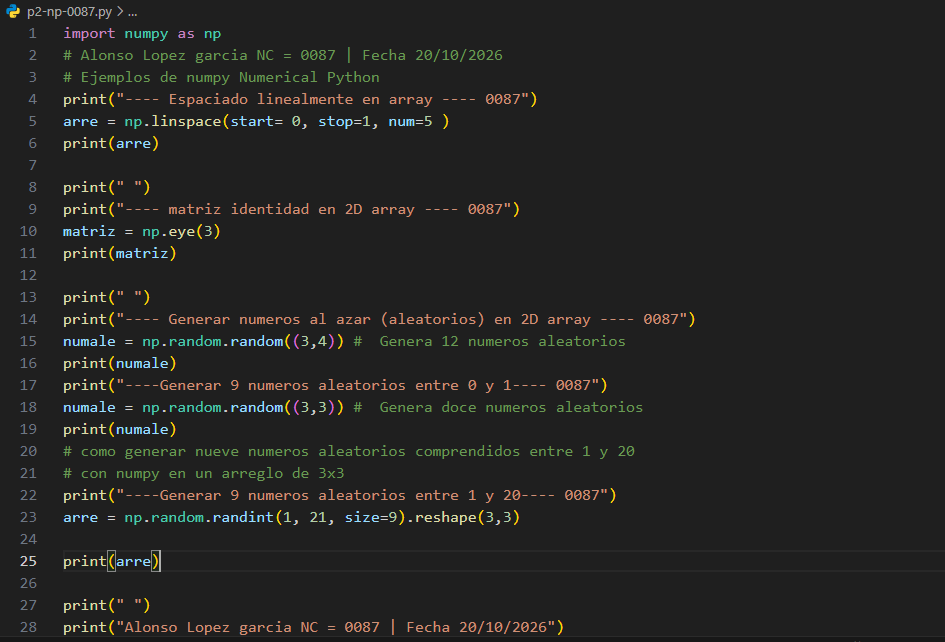
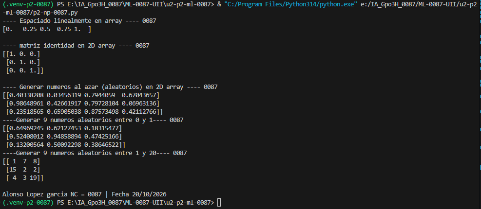

- start=0: Indica el valor inicial del intervalo, en este caso, 0.

- stop=1: Indica el valor final del intervalo, en este caso, 1.

- num=5: Indica la cantidad de números que se generarán, en este caso, 5.

## Que np.linspace
- np.linspace(): Es una función de NumPy que genera números espaciados uniformemente dentro de un intervalo.

# El codigo 

# El resultado
